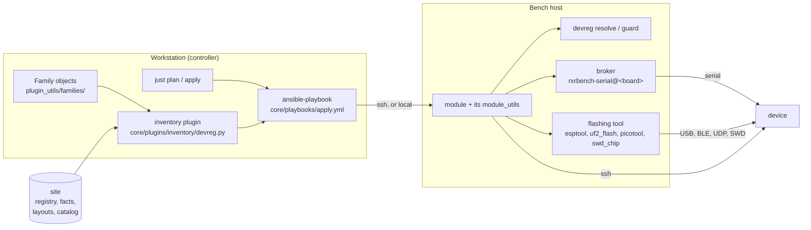

# rxrbench: architecture

How the tool is built, and the rules its code holds. [OVERVIEW.md](OVERVIEW.md) says what the
tool is; this page follows a run from the command line to the device and back, then states each
mechanism as a contract. Writing a plugin is [PLUGINS.md](PLUGINS.md); the modules, roles and
plugins have a generated reference (`just docs`).

`C/` stands for `collections/ansible_collections/rxrbench/`; `core/` is `C/core/`.

## The pieces

Left of the ssh hop is Python and Ansible on the workstation; right of it runs on the bench host
the board is plugged into, and only the device's own answer decides success.

| Piece | Where | What |
|---|---|---|
| Site | `site/` or `RXRBENCH_SITE` | one bench's layouts, registry, facts, catalog, secrets, `plugins.yml`, `rf_rules.yml`; `module_utils/site.py` is the one place its paths come from |
| Registry | `<site>/registry.yaml` | each device's identity, routes (`reach`) and policy ([REGISTRY.md](REGISTRY.md)) |
| devreg | `devreg/`, deployed to each bench host | `resolve` and `guard`, the gate before every hardware write |
| Facts | `<site>/facts/<name>.yaml` | what `just survey` found a device is and runs |
| Layout | `<site>/layouts/<name>/` | an Ansible inventory: devices and their declared state ([LAYOUT.md](LAYOUT.md)) |
| Catalog | `core/catalog/`, each plugin's, `<site>/catalog/` | board types (`boards.yml`), layered in that order; where images come from |
| Plugins | `<site>/plugins.yml` | the families beyond core's two |
| Broker | `core/host/broker/` | one process per board console; every other client goes through it |

## Terms: chip image, region, config

| Term | What it is | Reached through | Verbs |
|---|---|---|---|
| **chip image** | every byte of a chip's flash | the chip's loader, bootloader or a debug probe, the firmware stopped | chip backup, `restore-chip`, `erase-chip`, `snapshot`, `switch` |
| **region** | a named raw range of flash: a partition of an ESP-IDF table or a devicetree, or a range declared for a chip with no table. Those holding the firmware's config are its **config regions** | the same | region backup, `restore-regions`, `erase` |
| **config** | the firmware's configuration as it reads it: keys, channels, prefs | the running firmware, through its plugin | declared in the layout, written by `apply` |

"Partition" names only an entry of a partition table or devicetree. "Image" alone is an image to
write. "Settings" is kept for an upstream's own thing (Zephyr's settings store, Launcher's
settings). A region or chip backup is raw flash, so it holds the device's secrets in clear:
`backups/` is ignored by git and its files are mode 0600.

## Families as data

A **family** is the firmware a device runs: a row of a table plus a `Family` object for what is
not a field of the row. Core brings `zephyr_mcumgr` and `bare`; plugins bring the rest. A family no
loaded plugin brings is *foreign*: taken to transmit at its own defaults, warned about, left alone,
and a plan says it compares that board's image only.

On the workstation, the inventory plugin and tools import any collection and call a family's
`Family` hooks (`core/plugins/plugin_utils/families/base.py`). On a bench host only a module runs,
shipped with the `module_utils` it imports by name, and a core module imports no plugin. So each
family becomes a plain dict, `Family.spec(row)`; the inventory publishes the table as
`bench_families`; every module that reads a board or writes an image takes it as `families`
(`module_utils/familyspec.py` defines the keys).

## Core portability

`rxrbench.core` is a framework any family can use through a plugin:

| | Rule | Held by |
|---|---|---|
| P1 | Core runs without the bundled plugins: unit tests, and a simulated bench of core's families planned, applied and planned clean | `just core-only`, `tests/sim/test_core_only_sim.py` |
| P2 | Core holds no one family's knowledge (a format, command or behaviour of one firmware, board product or update system). What is common to a class is core's: ESP32 partition tables, MCUboot, UF2, SMP, ssh, debug probes | review |
| P3 | Core never chooses by family, plugin or board-type name: a difference is a hook, a spec field or catalog data | `test_portability.py` (AST and YAML) |
| P4 | Core imports no plugin | `test_portability.py` |
| P5 | Names in prose are free: P2 is about knowledge in code | `test_names.py` scans code only |
| P6 | A plugin can do anything a bundled plugin does, through the documented hooks | `test_plugins.py`, the fixture plugin `fixture.widgets` |

## A plan and an apply, traced

**The command.** `just plan <layout>` and `just apply <layout>` run
`ansible-playbook -i "$(tools/where.py <layout>)" core/playbooks/apply.yml [--check] --diff`.
`where.py` finds `<site>/layouts/<name>`, else `site.example/layouts/<name>`; a name that is only a
layer is refused (a layout of the same name wins). The plan is the same play under `--check`.
`ansible.cfg` enables the inventory plugin and the `community.sops.sops` vars plugin.

**The inventory.** `core/plugins/inventory/devreg.py` calls `module_utils/layout.py::load_layout`,
which reads the registry, layers the catalogs, expands `from:` and the layers, and per board finds
its bench host (`location.locate`), its connection and one route per verb (`routes.select`). Each
board's family says what its `firmware:` means (`image`), how its row narrows (`board_row`), which
task files and secrets it has; the answers become `bench_*` variables (`bench_plugin`,
`bench_vocabulary`, `bench_update`, `bench_flasher`, `bench_can`, ...). RF rules and each family's
`check_layout` run last. A `LayoutError` refuses the layout before any play. Each board becomes a
host carrying its bench host's connection, so a task "on the board" runs on the bench host.

**The play** (`apply.yml`), one board at a time (`-e parallel=N`), `any_errors_fatal`:

1. the gate (`playbooks/tasks/gate.yml`): skip a board the plug watcher does not see, or an ssh
   device that does not answer; outside `--check`, require `bench_apply_allowed`;
2. the broker check: a board whose family has a console and no broker socket fails before anything
   is read, naming `just hosts-setup`;
3. the update: the core role `board`, or with `bench_update` set, the plugin's `update_<word>.yml`;
4. the rescue: a failure marked `unanswered` skips the board; any other fails the run;
5. a closing play fails the run when no board answered.

The core role `board` stages the image, loads the board's facts, reports the chip findings, writes
with one module (`board_flash` for esptool, UF2 and sim; `swd_flash`, `picoboot_flash`,
`esp_image_flash`, `smp_flash`), forgets a bootloader read the write made stale, and includes the
family's config task file (`{{ bench_plugin }}.board`, `tasks_from: {{ bench_vocabulary }}`). A plan
of a first flash or family switch stops after the flash step.

**One write.** Every image write goes through `flash/common.py::drive` with a `common.Flasher`:
mark the board busy; **read** it (its family, another known family for a switch, or nothing for a
first flash, which needs `bench_first_flash`); **compare** with the image (`identity.same`), and
stop if the same; **refuse** (preflight, first-flash and switch refusals, the
[write rule](#partitions-and-the-write-rule)), all before anything is written; in check mode, return
the prediction; **write**, **verify**, **read again**. Success is the device reporting the image.
Config modules run the same cycle themselves: read, leave what matches, gate, write, read back.

## On the bench host

- **The write gate in every writing module** (`module_utils/gate.py`): a write needs
  `apply_allowed`, passed from `bench_apply_allowed`.
- **The broker.** `module_utils/broker_client.py` speaks JSON lines to
  `$XDG_RUNTIME_DIR/rxrbench/<board>.sock`; `broker.py` serves `exec`, `release`, `reacquire`,
  `attend`, `reset`, `status`, `mark`. It reads a Zephyr shell to a marker, or a one-line console by
  a dialect. Core ships no dialects: the host's `dialects.d/` holds the plugins' `host/dialects.d/`.
  It opens its port only through devreg (resolve, guard, `DevLock`, exclusive open) and scrubs
  secrets from its log. Unit `rxrbench-serial@<board>`; shell client `brokerctl.py`.
- **Host tools** (`core/host/bin/` and each plugin's, deployed to `~/rxrbench/bin`): `uf2_flash.py`,
  `swd_chip.py` (drives `openocd`), `swd_survey.py`, `chip_blocks.py`, `smp_stat.py`,
  `cp210x_serial.py`, `nrf_ids.py`. One venv per tool family (`~/.venv-esp`, `~/.venv-mcumgr`, ...)
  synced to lockfiles in `core/host/venvs/`. Paths: [LOCATIONS.md](LOCATIONS.md).
- **Getting there.** `just hosts-install <host>` (`install.yml`, role `default_install`): apt
  packages, pinned binaries checked by sha256, the venvs, the plug watcher (the relay timer on the
  workstation). `just hosts-setup <layout>` (`host.yml`, roles `bench_host`, `serial_broker`,
  `sim_bench`): devreg and the registry, host tools, the merged catalog (`~/rxrbench/catalog/`), the
  plugins' pinned downloads (`~/rxrbench/firmware/`), a broker per board with a console.

## Routes and presence

The registry's `reach` block gives each device its bearers (`usb`, `ssh`, `swd`, `ble`, `eth`,
`wifi`) and what each can do (`flash`, `shell`, `config`, `diag`). One route per verb is chosen when
the inventory is built: USB first, a layout may pin one, and a run never falls back.

A board's bench host is where the plug watcher sees it (`module_utils/location.py`); the layout's
or registry's host is a hint. A board the watcher would know by chip id or MAC and does not see is
absent and skipped. A board with no such identity (a bridge on its factory serial, a network node)
is assumed present with a warning, and its first read decides: a device not there to read raises
`unanswered`, and the play skips it.

## Identity

`module_utils/identity.py` gives an image and a device one shape (family, target, version, build or
hash, and the family's identity key, such as `class`), so "needs flashing" is a comparison. A device
is read from its [state line](PLUGINS.md#the-state-line) by the keys its family names, else by a
probe tool or one console command's prose answer. The swd, picoboot and esp-image flashers hash the
chip over what the image writes instead. A bootloader's identity is `module_utils/bootid.py`: for
MCUboot the signing key decides, and the exact bytes only under policy `exact`.

## Flashers

Core's flashers are `common.FLASHERS`; the levels beside writing an image are `common.CAPABILITIES`,
published per board as `bench_can`. A plugin declares its own ([PLUGINS.md](PLUGINS.md#what-a-plugin-exports)).

| Flasher | Writes | Bearers | Levels |
|---|---|---|---|
| `esptool` | an ESP32 application slot | usb | regions, chip |
| `esp-image` | a whole merged ESP32 image linked for 0x0 | usb | regions, chip |
| `uf2` | an app through a UF2 bootloader drive that carries the board's serial (nRF52840) | usb | none |
| `picoboot` | an RP2040 or RP2350 through its ROM bootloader | usb | regions, chip |
| `swd` | a chip behind a debug probe, at the image's `base` | swd | regions, chip |
| `smp` | an MCUmgr image upload | usb, ble, eth, wifi | none |
| `sim` | a simulated board | sim | chip |

`card` is not a flasher: `just card` writes a disk image through a registered SD reader
(`card_write`). Only `swd` writes at an address other than the start of flash: an image staged from
Intel HEX or ELF (`tools/stage_raw.py`) is `raw-bin` with its lowest address as `base`, and every
other flasher refuses one.

- **esp-image**: an *update* (the board is on the image's partition table) writes the app
  partitions that differ, and otadata when it boots another slot, keeping bootloader, table and
  data. A *full install* (first flash, or `-e bench_full_erase=true`) makes the chip the staged
  file, in the 64 KB blocks that differ. The MAC, read in the write's session, must be the
  registry's.
- **swd**: the registry's `reach.swd: {host, probe, chip, uid, nrst}`. The probe is found by name
  and USB location (`devreg resolve --busid`), so two probes on a host each reach their own chip;
  the chip's unique id is read in the same session as the work, which ends if it differs. A chip
  that stops its debug clock in sleep needs `nrst: true`.
- **picoboot**: `picotool` selects the chip by its flash unique id (the registry's `usb_serial`) in
  every session. The board type's `uf2.enter` lists the ways into the bootloader in order
  (`reset-interface`, `touch-1200`, `shell:<command>`, `manual`); a board the run put there is
  rebooted at the end, in a plan too.

## Entering UF2 mode

`uf2_flash.py` touches a board type whose 1200-baud touch gives the drive. Otherwise the running app
is asked by a family's `uf2_enter` (a shell command on given USB vendors, or an app tool), from the
entries `flash/uf2.py::tool_env` passes as `UF2_ENTERS`:

| Known | Entries |
|---|---|
| the family `drive()` read | that family's alone; none if it has no `uf2_enter` (the tool names `UF2_ENTER=manual`) |
| nothing read, `bench_uf2_enter_as` set | that family's alone; a read naming another family refuses with both |
| nothing read | every family's, the image's first; a shell command only if exactly one family's `shell_usb` matches, else a refusal naming them |

The plan makes the same choice, so an ambiguity shows before an apply; the tool prints the entry
and its family.

## First flash, family switch and bootloaders

- **First flash** (`bench_first_flash: true`): an ESP32 is erased whole and gets bootloader and
  app, refused unless its facts show secure boot and flash encryption off, ROM download on and the
  board type's PSRAM. A UF2 board only once its bootloader reads as the one wanted.
- **Family switch**: on a UF2 board the same app copy; the board is asked into UF2 mode in the way
  of the family it runs.
- **`just boot`**: an ESP32's MCUboot by esptool (decide by key, write keeping the header, read
  back); any other bootloader by its plugin's step (`Family.bootloader_tasks`).

## Partitions and the write rule

Safety comes from comparing what is on the chip with what the write brings, never from recognising
a product. The **region inventory** (`module_utils/regions.py`) lists a chip's regions with an owner
(`declared`, `foreign`, `empty`, `unknown`) and evidence, from:

| Chip | Layout source |
|---|---|
| ESP32 | the partition table at 0x8000 |
| MCUboot | the image's flash map: `SLOT*` are app regions, the bootloader's space `boot`, the rest data |
| no table | declared ranges `[{label, kind: boot\|app\|data, start, size, role?}]`: the catalog image's `regions:`, else the family's `flash_regions`; overlaps, or `role: config` off a data region, refused at load |

**Recognisers** (data: a magic at an offset) say whether a region holds an image, never whose.
Core's cover ESP32 apps and MCUboot images; a plugin adds its own.

**What is the layout's**: the board's *boot app* (ESP32: the `ota_N` otadata selects, else factory,
else the first app; MCUboot: the primary slot) and its rollback copies (other `ota_N` slots when
there is no factory or test app). With a factory or test app beside `ota_N` images, only the boot
app is the board's. What a write covers is never evidence of ownership.

**The rule**, asked before every write: refuse one that destroys a region holding firmware the
layout does not own, a new table that drops such a region, a write outside every region, or a write
over a `boot` region. `bench_overwrite: [<label>...]` or `[all]` (`bench_app_manager_overwrite:
true`) names what a write may take. On ESP32 it is `common.esp_write_refusals`; a plan asks
`recorded_write_refusals` over the survey's record, for the same verdict. A flasher that offers
`read_range` and `write_ranges()` gets the rule over declared ranges from `drive()`.

On a chip with an app manager, data regions are shared by every app: a region erase or restore
there needs the region in `bench_overwrite`; a chip restore refuses a chip with a manager its backup
lacks, and a bootloader write refuses a chip with a manager, without the go-ahead. A plan reports
foreign regions as information (`bench_foreign: info | warn | refuse`); `Family.chip_regions` lets a
plugin say what its declaration owns there and describe it, and core's refusal never depends on it.

## Chip and region flows

One flow per verb; a route supplies only its session, the chip identity it records, its proof that
the board runs the image whose map applies, and its range operations. No module's `main()` holds
route code.

| Level | Flow | Routes (`flash/access.py`) | Modules |
|---|---|---|---|
| region | `region_flow.Route`, `Session` | `ROUTES`: esptool, esp-image, picoboot, swd | `region_backup`, `region_restore`, `region_erase` |
| chip | `chip_flow.ChipRoute`, `ChipSession` | `CHIP_ROUTES`: picoboot, swd, esptool (esp-image too); sim for a simulated board | `chip_backup`, `chip_restore`, `chip_erase` |

Config regions are the declared ranges with `role: config`, else the image's flash map entries the
family's `config_regions` names. Every backup records its chip (`mac`, `chip_id` or `uid`); a
restore refuses another board's, route's or chip's backup, a wrong size and a wrong hash. A chip
restore writes the blocks that differ and must hash to the backup after. A plugin's flasher reaches
these verbs through `chip_tasks` ([PLUGINS.md](PLUGINS.md#task-files)).

- `just erase <layout> <board> <region>` erases one named config region (esptool, esp-image,
  picoboot, swd, or a plugin's `region_erase`); with none named it erases nothing and lists them.
- `just erase-chip <layout> <board>` erases the whole chip (picoboot, swd, esptool, esp-image, sim,
  or a plugin's `chip_tasks.erase`).

Neither applies to a UF2-only board (nRF52840), an SMP board or a board under an app manager.

## Checking depth

`bench_check_depth` is `full` (default) or `spot`, per layout, board or run.
`module_utils/depth.py::resolve` gives each read `{depth, reason}`: `spot` only when asked, when the
flasher lists the read in `spot_reads`, and when no moment forces full (a first flash, family
switch, bootloader change, table change, erase, restore, no full record yet, or an apply's identity
read). Depth never changes whether a gate, RF rule or refusal applies.

| Read | Spot form |
|---|---|
| `before write` (esptool, esp-image) | the table and the heads of the slots the write overlaps, the only ones it can destroy; misses the inventory of the rest |
| `identity` (esp-image, smp) | in a plan only, the board's last full read (`~/rxrbench/state/last-read/<board>.json`) when the same plug watcher has run since, the board is on the same port, the watcher's log shows no add or remove of it since, and the record shows the declared image |

The identity record misses a change with no USB event (another tool writing through a bridge, an
update over the air, an MCUboot revert); `drive()` deletes it before any write. A bench others write
to keeps `full`. Results carry `checked` and `identity_checked`.

## Plug watcher and busy marks

- **The watcher** (`core/host/plugwatch.py`, a user service per bench host) keeps
  `~/rxrbench/state/usb-present.json` from sysfs and logs adds and removes. It writes to no device
  and opens no port, with one exception: a VID:PID a board type declares as a bootloader that hides
  the chip id (`uf2.hides_chip_id: true`, `uf2.identify: picotool`: an RP2040's ROM) gets a
  read-only `picotool info --bus --address --ser <id>` per registry candidate, once per enumeration,
  with a timeout. The id that selects it is recorded as `chip_id`; none leaves it unidentified, and
  the bootloader's own serial is never taken as an identity.
- **The relay** (`tools/plug_relay.py`, every 30 s on the workstation) reads each host's snapshot;
  a change held across two readings runs the passive survey and posts to ntfy
  (`RXRBENCH_BENCH_NTFY`). Its state is the index `location.py` reads.
- **Busy marks** (`~/rxrbench/state/busy/<name>.json`: board, port, chip ids, time limit) are set by
  `common.drive()` and picoboot chip sessions and outlive the work by 75 s. The relay holds a busy
  board as last reported; the watcher defers its query; the survey skips the port and reports it
  `held`.

## Survey and enroll

`just survey [host] [deep]` (module `usb_survey`) classifies each USB device by its descriptors
(core's kinds plus the plugins' `USB_KINDS`), matches it to the registry, and asks it what it runs
only through its broker or on a port no process holds, the way each family's `survey` says.
`deep=true` resets ESP32 boards for chip and eFuse facts. `just enroll <name> <ident>` turns a
device's facts into a registry entry and deploys it; a board behind its built-in debug probe becomes
two entries, probe and chip (`--probe-name`, default `stlink-<board>`).

## Safety rules, in code

| Rule | Enforced in |
|---|---|
| A hardware write resolves the device by name and guards its path | `devreg resolve`/`guard`; `common.guarded_port` |
| A route with no path (BLE, UDP, ssh) is guarded by address before connecting | `devreg guard --route`; `common.route_refusal` |
| Nothing is written without the layout's go-ahead | `bench_apply_allowed`: `tasks/gate.yml` in every writing play, `module_utils/gate.py` in every writing module |
| A failure on a present board stops the bench | `any_errors_fatal`, one board at a time; only `unanswered` skips |
| A first flash is declared | `bench_first_flash`; ESP32 security, ROM download and PSRAM checks |
| A write never destroys firmware the layout does not own | the write rule; `bench_overwrite` |
| A restore goes only to the chip it was read from | the recorded `mac`, `chip_id` or `uid`; `region_flow`, `chip_flow` |
| `erase-chip` erases only the registry's chip, only with a backup, and is proved | `chip_erase`, `erase-chip.yml`: one board per run; refused without a chip backup of this board read from this chip unless `-e erase_without_backup=true`; the chip identity read in the erasing session; the chip must read erased after |
| `erase` erases only the region named | `access.erase` |
| Writes outside apply are plans unless confirmed | `confirm=apply` for `boot`, `restore-regions`, `restore-chip`, `switch`, `keys-restore`, `erase`, `erase-chip`; `-e card_confirm=<reader>` for `card`; `test_hygiene.py` |
| A plan resets no board (picoboot entry aside) | `just boot` decides from the bootloader last read (`-e boot_read=true` reads); a switch's key read waits for the apply; no deep survey |
| One owner per port | the broker holds the port's `devlock` and opens it exclusively; a flash `release`s both; a client deadline of at most ten minutes |
| A Bluetooth bond is removed only on the board's word | `flash/smp.py` asks the board which bonds it holds (`bench_ble_rebond`); a plan removes none |
| RF rules hold at load and at the write | `rfrules.py`, `rflayout.py` (a site's region; a layout may only tighten); a plugin's radio modules check the block in hand |
| Secrets never reach a log, argv or commit | SOPS in the site, compared by fingerprint; the broker scrubs a named secret |

## Runs, tests and campaigns

A run is `runs/<time>/`, and its files are the record.

- **State record**: `just run <layout>` plans with the callback `rxrbench.core.state`, writing
  `state.json` (the tool's and site's commits; per board what was declared, what the device reported
  from any task result carrying `device` and `image`, whether it answered; and `clean`). Device tests
  and scenarios run beside it.
- **Timing**: the callback `rxrbench.core.timing` writes `timing-<play>.json` (tasks per board, and
  module phases from `module_utils/timing.py`); `just timing` reads them across runs.
- **Library tests**: `<site>/tests/<name>.yml` (`needs.roles`, steps naming boards as `$a`), bound
  per layout by `bench_test_bindings`; the tool never binds by itself, and a bad binding refuses the
  whole run.
- **Campaigns**: `<site>/campaigns/<name>.yml`, states that are layouts with overrides (never a
  go-ahead). `just campaign` plans, applies, plans clean and tests each; a failed apply or unclean
  bench stops it.
- **Compare**: `just compare` reports per test `same`, `changed`, `only in` or `not comparable`,
  beside what changed on the bench; it refuses an unclean run (`--unclean`) or mixed identity depth
  (`--mixed-depth`).

## The tool's own tests

`tests/unit/` is pure Python; `tests/sim/` runs real plays on the simulated benches
([SIMULATED.md](SIMULATED.md)), each skipping until its images are built; `tests/hw/` needs the
boards in `RXRBENCH_HW_BOARDS` and is never part of `just test`; `tests/golden/` holds each example
layout's resolved variables. Each tree check names the requirement it protects and says the ways
out of a failure: fix the design, or record an exception inline with its reason, never a rewording
to pass. [CONTRIBUTING.md](../CONTRIBUTING.md) says how to run them.

## Where the code lives

| Path | What | Runs on |
|---|---|---|
| `justfile`, `ansible.cfg` | entry points | workstation |
| `tools/` | where, show, golden, enroll, survey store, plug relay, run, campaign, compare, timing, staging, doctor, privacy check | workstation |
| `devreg/` | resolve, guard, busy, deploy; `devlock.py` | both |
| `site.example/` | the example site; the simulated benches' registry and catalog in `sim/` | data |
| `core/plugins/inventory/`, `plugin_utils/` | the inventory plugin; the families table and plugin loader | workstation |
| `core/plugins/module_utils/` | workstation: `layout`, `layers`, `routes`, `location`, `rflayout`, `site`. Shipped with modules: `broker_client`, `familyspec`, `identity`, `stateline`, `gate`, `depth`, `lastread`, `regions`, `esppart`, `bootid`, `hwsurvey`, `timing`, `flash/*` | both |
| `core/plugins/modules/` | `board_*` (an MCU board), `region_*`, `chip_*` (a whole chip), `<flasher>_flash`, `bootloader_flash`, `card_write`, `swd_identify`, `usb_survey`, `device_run` | bench host |
| `core/plugins/{lookup,filter,callback}/` | `bench_plugins`, `library_tests`; `chip_findings`, escrow; `state`, `timing` | workstation |
| `core/host/` | `bin/`, `broker/`, `plugwatch.py`, `binaries.yml`, `venvs/` | bench host |
| `core/roles/` | `board`, `bench_host`, `serial_broker`, `default_install`, `sim_bench` | bench host |
| `core/playbooks/` | apply, facts, survey, host, install, boot, card, backup, snapshot, restore-regions, restore-chip, switch, erase, erase-chip, secrets, keys-export, keys-restore, locate, reboot, diag, test, scenario | workstation |
| `core/catalog/`, `core/sim/` | board types; the simulated bench and bench host | workstation |
| a plugin | [PLUGINS.md](PLUGINS.md#what-a-plugin-is) | |
